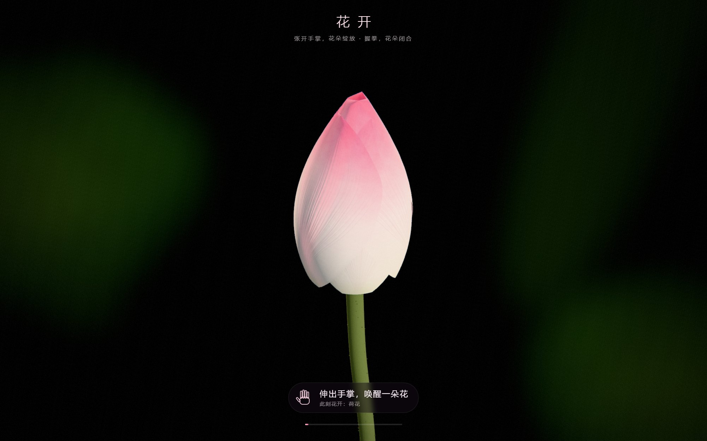
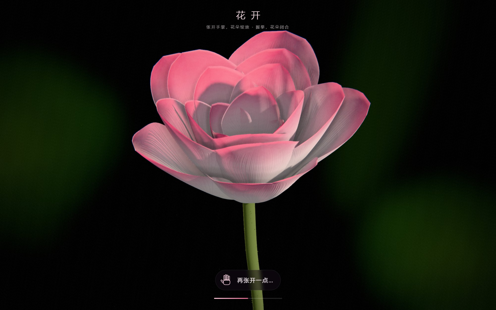
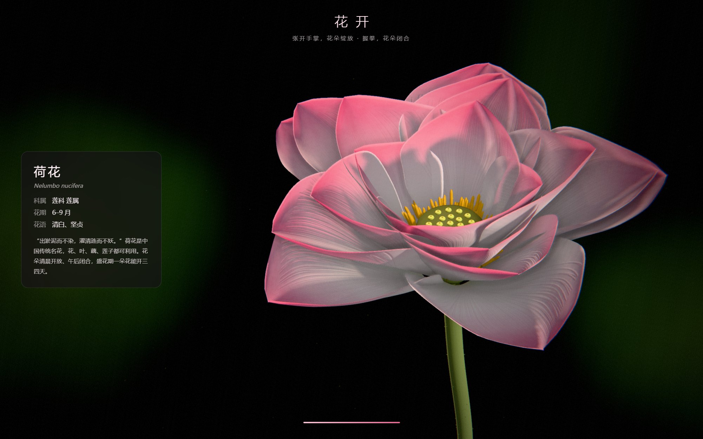

# 花开 · 手势控制 3D 花朵

花卉博物馆的互动展项：游客张开手掌，花朵绽放；握拳，花朵闭合；开满时花粉飞散，弹出这朵花的知识卡。

<p align="center">
  
  
  
</p>

- **手势识别**：Google MediaPipe HandLandmarker 轻量模型（约 7.8 MB），在本机运行，**不联网、不上传任何画面**
- **写实 3D 花朵**：Three.js 程序化建模，按微距花卉摄影的思路渲染——花瓣逆光透光、细密叶脉、背景大光圈虚化、花瓣夹缝阴影、胶片质感；内置荷花（含莲蓬、荷叶）、郁金香、半重瓣牡丹，轮流展示
- **完整展项流程**：待机吸引 → 互动 → 盛开高光 → 知识卡 → 游客离开后换下一种花
- **适合无人值守**：全屏锁定、防休眠、崩溃 / 卡死自动恢复、每日定时重启、运行日志
- **员工可自己改内容**：花朵外观、科普文案、展项设置都在 `content` 文件夹的 JSON 文件里，改完重启程序即可，不用重新打包
- **跨平台**：Windows / macOS

## 下载

到本仓库的 **[Releases](../../releases)** 页面下载最新版本：

| 你的电脑 | 下载这个文件 |
|---|---|
| Windows 10 / 11（64 位） | `HuaKai-版本号-win-x64.zip` |
| Mac（M1 / M2 / M3 / M4 芯片） | `HuaKai-版本号-mac-arm64.dmg` |
| Mac（Intel 芯片） | `HuaKai-版本号-mac-x64.dmg` |

> 不确定 Mac 是哪种芯片：点屏幕左上角  →「关于本机」，“芯片”一栏写 Apple M… 就选 arm64，写 Intel 就选 x64。

## 30 秒上手

1. 安装并打开程序（Windows 解压后双击 `HuaKai.exe`；Mac 打开 dmg 拖进「应用程序」），允许使用摄像头
2. 程序会全屏运行。站到摄像头前 1~2 米，伸出手掌：张开 → 花开，握拳 → 花合
3. 工作人员打开管理面板：依次点击屏幕 **左上 → 右上 → 右下 → 左下** 四个角，或按 `Ctrl+Shift+A`，输入密码（默认 `2580`）
4. 退出程序：管理面板里点「退出程序」，或按 `Ctrl+Alt+Shift+Q`

安装时的安全提示、管理面板各项功能、现场布置建议，请看 👉 **[详细使用教程](docs/使用教程.md)**

## 想换一种花、改文案？

花朵颜色、层数、片数、张开角度、花蕊，以及知识卡上的花期、花语、简介，都写在 JSON 文件里，**不用改代码、不用重新打包**。
👉 **[自定义花朵指南](docs/自定义花朵.md)**

## 后续规划

从原型到馆内正式展项、再到可复用的展项平台，产品设计、技术架构和实施路线见 👉 **[产品与架构蓝图](docs/产品与架构蓝图.md)**

## 开发者

需要 [Node.js](https://nodejs.org/) 20 或更高版本。

```bash
npm install          # 安装依赖
npm run dev          # 浏览器预览：http://localhost:5173（管理面板不需要密码）
npm run app          # 桌面程序，窗口模式
npm run app:kiosk    # 桌面程序，展台模式（全屏锁定，Ctrl+Alt+Shift+Q 退出）
npm run dist:win     # 在 Windows 上打包 → release/
npm run dist:mac     # 在 Mac 上打包 → release/
```

**用 GitHub 同时打包两个平台**：打开仓库的 Actions 页 → 左侧选 `build` → 右侧 `Run workflow`。约 5 分钟后，在这次运行页面底部的 Artifacts 里下载 `HuaKai-Windows` 和 `HuaKai-macOS`。（macOS 安装包只能在 Mac 上构建，没有 Mac 就用这个方法。）

### 项目结构

```
src/
├─ vision/             交互引擎
│  ├─ handTracker.ts   摄像头与手势模型
│  ├─ interaction.ts   互动区、目标锁定、防误触
│  └─ openness.ts      手掌张开度计算、每位游客自动校准
├─ flora/              花卉引擎
│  ├─ spec.ts          花朵数据格式（FlowerSpec）校验与换算
│  ├─ Flower.ts        花瓣建模与开合动画
│  ├─ petalMaterial.ts 花瓣材质（薄片透光）
│  ├─ parts.ts         花心（莲蓬、花蕊、雌蕊）、叶子、荷叶
│  └─ textures.ts      花瓣、叶子、荷叶纹理与法线贴图（程序生成，无图片）
├─ stage/              体验编排
│  ├─ experience.ts    状态机：待机 → 互动 → 盛开 → 知识卡 → 复位
│  ├─ overlay.ts       提示、盛开横幅、知识卡
│  ├─ sound.ts         背景音与盛开音效（实时合成，无音频文件）
│  └─ admin.ts         隐藏的管理面板
├─ scene.ts            相机、灯光、后期（环境光遮蔽、泛光、胶片）、换花动画
├─ backdrop.ts         背景单独虚化（大光圈效果）
├─ config.ts           读取展项配置与花朵数据
└─ main.ts             主循环
public/content/        内容：exhibit.json（展项配置）、flowers/*.json（花朵）
public/models          手势模型 hand_landmarker.task
public/wasm            MediaPipe 推理引擎
electron/main.cjs      桌面程序主进程（展台模式、看门狗、日志、外部内容目录）
electron/preload.cjs   页面可调用的桌面功能
.github/workflows      云端打包流程
```

### 原理

摄像头画面 → MediaPipe 识别手部 21 个关键点 → 只保留互动区内、足够大的手，并锁定其中一只 → 计算「指尖到手腕的平均距离 ÷ 手掌长度」得到张开度（握拳约 1.0，张开约 2.0）→ 按这位游客的实际范围自动校准到 0~100% → 体验状态机决定花该开多少 → 驱动每片花瓣从“花苞形态”转到“盛开形态”。
