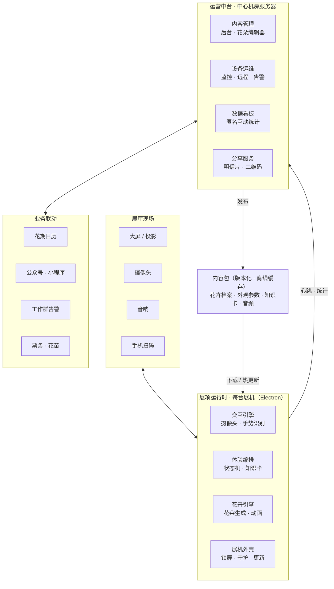

# 花开 · 花卉博物馆互动展项：产品与架构蓝图

[← 返回首页](../README.md)

现在的 v0.1 是一个已经验证过的原型：一朵花、一只手、一个桌面程序。这份蓝图要做两件事：

- 把它变成能在馆里每天开放、无人值守的正式展项；
- 把手势识别和花朵生成做成通用底座，馆里以后的其它互动展项都能直接用。

> **进度（v0.2）**：阶段 1 的软件部分已完成：完整体验流程（待机 → 互动 → 盛开 → 知识卡 → 换花）、互动区与目标锁定、每位游客自动校准、花朵数据化（FlowerSpec JSON，含荷花 / 郁金香 / 牡丹）、外部内容目录、合成音效、隐藏管理面板、展机外壳（全屏锁定、防休眠、崩溃 / 卡死 / 意外关闭自动恢复、心跳看门狗、每日重启、日志）。
> 尚未完成：远距离“先找手腕再裁剪”识别、识别移到 Web Worker、花瓣形变移到 GPU、现场实测与 2 周试运行。

---

## 一、产品定位

**一句话**：游客用一个手势，唤醒一朵中心亲手种出来的花，再被引到温室里去看真花。

普通互动大屏到处都有。这个馆的独特之处在于它属于一个种植中心，所以数字花要和真实种植连起来：屏幕上的品种就是中心种的品种，花期和温室同步，知识卡直接告诉游客"这种花正在 3 号温室开着"。

**四个目标**

- 吸引：做成全馆的打卡点，让人停下来、愿意拍照。
- 科普：每朵花都带知识，比如科属、花期、花语、怎么种。
- 导流：从数字花把人引到温室，再到研学课程和花苗购买。
- 好运营：馆里员工不写代码，也能换花、改文案、看数据。

## 二、用户与场景

| 人群 | 特点 | 设计对策 |
|---|---|---|
| 亲子家庭 | 孩子主导，手小，喜欢反复玩 | 只用一个核心手势，反馈即时，盛开时有奖励动画 |
| 研学、学校团队 | 讲解员带队，人多 | 讲解员模式：用平板遥控切花、暂停、定格讲解 |
| 普通游客、老人 | 爱拍照，不熟悉手势 | 醒目的引导动画；另备一个实体按钮作为备选 |
| 馆方员工 | 策展、园艺、运维人员，不懂代码 | 在后台改内容、看设备状态和数据 |

## 三、核心体验流程

| 阶段 | 触发条件 | 画面与反馈 |
|---|---|---|
| 待机吸引 | 没人 | 花朵缓慢"呼吸"式开合，屏幕提示"伸出手掌，唤醒一朵花" |
| 感知 | 有人走进互动区（地贴，距屏约 1.5 米） | 出现手势动画，花朵微微转向游客 |
| 互动 | 识别到手 | 张开花开、握拳花合，保留现在的核心玩法 |
| 盛开高光 | 完全张开并保持约 1 秒 | 花粉爆发、播放音效，显示"你唤醒了一朵郁金香" |
| 知识与导流 | 高光之后 | 弹出知识卡：花名、花期、花语、"2 号温室正在盛开"，附二维码 |
| 复位 | 人离开约 10 秒 | 花慢慢合上，换成下一种花，回到待机 |

- 一轮控制在 30–60 秒，人多时也能快速轮换。
- 多人同时伸手时，只认互动区里最近、最靠中间的那只手，锁定到这个人离开为止。
- 如果以后换成大屏，可以加"花园模式"：每人一朵花，同时开放。

## 四、功能分级

- **P0，上线必须有**
  - 展机模式：开机自启、全屏锁定、崩溃后自动恢复。
  - 上面的整套体验流程。
  - 互动区和多人规则；自动校准，去掉现在的手动校准按钮。
  - 中心主推的 3–5 个真实品种，配知识卡和音效。
  - 隐藏的管理入口：屏幕四角连点再输密码，可以看摄像头画面、调互动区、调音量。
- **P1，便于运营**
  - 内容后台和可视化花朵编辑器，内容远程更新。
  - 设备监控和告警，数据看板。
  - 按中心花期日历自动轮换"当季花"。
  - 中英双语，讲解员模式。
- **P2，扩大传播**
  - 花朵明信片加二维码，接入公众号和小程序。
  - 花园模式；"挥手换花""从种子长成花"等新手势。
  - 导流到温室预约、研学报名和花苗购买。

## 五、技术架构



设计上有三条原则：

- **展机独立运行**：识别和渲染全部在展机本地完成，断网也照常开放。现在"不联网、画面不出本机"的做法保持不变。
- **内容和程序分开**：换花、改文案只更新内容包，不用重新打包程序。
- **中台不参与实时互动**：只负责内容、运维和数据，中台出故障也不影响展厅。

### 5.1 从现有代码到目标

| 现状（v0.1） | 放到展厅后的问题 | 改造方向 |
|---|---|---|
| 花朵参数写死在 `src/flower/Flower.ts` | 换花要改代码、重新打包 | 花朵参数改成数据文件（FlowerSpec），配可视化编辑器 |
| 单手、近距离、手动校准 | 游客站 1.5–2 米远，多人围观，没人会去点校准 | 互动区、目标锁定、自动校准、先裁剪再识别 |
| 识别和渲染在同一线程 | 4K 大屏或多朵花时会掉帧 | 识别移到后台线程（Web Worker），花瓣变形交给显卡计算 |
| `src/main.ts` 是一段线性逻辑 | 加上待机、知识卡以后会越来越乱 | 改成体验状态机，加一套统一的交互事件 |
| 普通桌面程序 | 会被人关掉、会休眠，崩溃了也没人知道 | 展机外壳：锁定全屏、防休眠、守护重启、每日重启、心跳上报 |
| 程序没有数字签名 | 被 Windows 的智能应用控制拦截 | 展机统一装 Windows 11 IoT 企业版 LTSC 并开展台模式；如果要对外分发，再买代码签名证书 |
| 在 GitHub 上手动打包 | 多台展机要一台一台更新 | 程序分稳定、测试两个更新通道；内容包单独热更新 |

### 5.2 代码结构

改成一个仓库里放多个包（monorepo），现有代码拆进对应模块：

```
huakai/
├─ packages/
│  ├─ vision/   交互引擎：摄像头、手势、人员选择、自动校准 → 输出统一事件
│  ├─ flora/    花卉引擎：FlowerSpec → 3D 花朵（由现在的 Flower.ts 演进）
│  ├─ stage/    体验编排：状态机、知识卡、引导界面、音效
│  └─ shared/   公共类型、FlowerSpec 校验规则、事件协议
├─ apps/
│  ├─ exhibit/  展项程序（Electron，由现在的项目演进）
│  ├─ admin/    运营后台和花朵编辑器（复用 flora 做实时预览）
│  ├─ server/   设备心跳、内容发布、数据统计接口
│  └─ h5/       扫码页面（知识详情、明信片）
└─ content/     内容源文件：花卉档案、图片、音频、文案
```

### 5.3 三个关键设计

**① 统一交互事件**

交互引擎只往外发标准事件，体验逻辑只认这些事件：

```ts
type InteractionEvent =
  | { type: 'presence'; people: number }                                  // 互动区人数
  | { type: 'hand'; id: number; openness: number; x: number; y: number }  // openness 为 0~1
  | { type: 'gesture'; id: number; name: 'swipe-left' | 'swipe-right' }
  | { type: 'hand-lost'; id: number };
```

好处是输入设备可以随时替换：深度摄像头、触摸屏、实体按钮，甚至一段录好的视频（用于自动测试），花朵和体验代码都不用改。馆里以后的其它展项也直接接这套事件。

**② 花朵数据化（FlowerSpec）**

一种花就是一份数据，外观和知识写在一起：

```json
{
  "id": "tulip-red",
  "name": "红色郁金香",
  "appearance": {
    "petalColors": [[0, "#f4c534"], [0.32, "#e5482e"], [1, "#b81d2c"]],
    "layers": [
      { "count": 3, "length": 1.15, "width": 0.55, "openAngle": 54, "cup": 0.85 },
      { "count": 3, "length": 1.08, "width": 0.52, "openAngle": 40, "cup": 0.9 }
    ],
    "sepals": false,
    "stamens": { "count": 6, "color": "#2a1a26" }
  },
  "knowledge": {
    "latin": "Tulipa gesneriana",
    "family": "百合科 郁金香属",
    "bloom": "3–5 月",
    "meaning": "爱的告白",
    "inCenter": "2 号温室"
  }
}
```

- 编辑器里只给员工看直观的参数：花瓣数、长短、宽窄、张开角度（用度数，不用弧度）、颜色。
- 花苞半径、花瓣错开距离、各层开放延迟由程序自动推算。这样[《自定义花朵指南》](自定义花朵.md)里那三条容易出错的规则，就不用靠人记了。
- 指南里郁金香和牡丹两个示例的外观已经实际验证过，可以直接作为第一批数据。

**③ 内容包与离线优先**

- 后台点"发布"后，生成一个内容包：花卉数据、图片、音频，加一份清单和校验码，版本号递增。
- 展机定时在后台检查新版本，下载并校验，等到"复位"时悄悄切换。新版本有问题，一键回滚到上一版。
- 断网时继续用本地缓存的内容。
- 支持排期：在后台设"4 月主推牡丹"，展机到时自动轮换。

### 5.4 展厅环境下的识别可靠性

这是整个项目最大的技术风险，要最先在现场验证。

- **互动区**：地面贴"站在这里"的标识。程序只认画面中间区域里足够大的手，围观人群的手不算。
- **目标锁定**：多只手同时出现时，选最近、最靠中间的那只；这个人离开约 1.5 秒后才换下一个人。
- **自动校准**：每位游客玩的时候，程序动态学习他握拳和张开的范围，缺数据时用默认值兜底。
- **远距离识别**：摄像头换成 1080p。先用轻量的人体关键点模型找到手腕位置，再把手部区域裁出来放大，交给手部模型识别。现在是把 640×480 的整幅画面直接送进去识别，人站远了手就太小。
- **光线**：锁定摄像头的曝光和白平衡，否则屏幕亮度一变，自动曝光就会来回跳。机位避开窗户逆光，必要时加柔光补光。
- **防误触**：连续几帧都检测到才算"有手"；手短暂丢失时先保持状态，不立刻判定离开。
- **回归测试**：录一套测试视频，覆盖不同身高、距离、光线和手型。以后每次改识别算法，都自动跑一遍识别率。

### 5.5 性能与长期稳定

- **目标**：渲染保持 60 帧；从做出手势到花朵响应不超过 100 毫秒。
- **算力**：现在每帧在 CPU 上重算约 1 万个花瓣顶点，一朵花够用；花园模式有 20 朵花时必须交给显卡计算。手势识别放到后台线程，不和渲染抢资源。
- **长期运行**：展机每天要连续运行 10 小时以上。上线前做 72 小时连续运行测试并监控内存；闭馆时自动重启或关机。
- **故障自愈**：页面崩溃自动重新加载；程序卡死时由系统守护进程重启，同时向工作群告警。

### 5.6 技术选型

| 部分 | 选型 | 说明 |
|---|---|---|
| 3D 渲染 | Three.js | 保留 |
| 手势识别 | MediaPipe 手部模型，加人体关键点模型 | 保留并扩展，都用轻量版，本地运行 |
| 展机程序 | Electron + electron-updater | 保留，增加自动更新 |
| 工程 | Vite + TypeScript + pnpm 多包仓库 | 保留，按模块拆包 |
| 内容后台 | Directus（开源内容管理系统，自己部署） | 自带管理界面、权限和发布状态，不用从零开发 |
| 设备与数据服务 | Node.js（Fastify）+ PostgreSQL + MinIO | 轻量自研，处理心跳、统计和内容包发布 |
| 花朵编辑器 | 复用花卉引擎，配参数面板 | 嵌在后台里，改参数即时看到效果 |
| 部署 | Docker Compose，放在中心机房一台服务器或 NAS 上 | 局域网内可用，外网断了不影响展厅 |
| 告警 | 企业微信或钉钉机器人 | 设备离线、摄像头故障时即时通知 |
| 展机系统 | Windows 11 IoT 企业版 LTSC + 展台模式 | 长期支持，便于统一管理；可向工控机或迷你主机供应商买预装版 |

### 5.7 硬件参考

- **主机**：迷你主机，近两代 i5、i7 或锐龙 7，用核显就能跑一朵花；如果上 4K 大屏或做花园模式，选 RTX 4060 级别的独立显卡。
- **摄像头**：1080p、60 帧、广角、支持手动曝光的 USB 摄像头。装在屏幕上沿正中，向下倾 10–15°。
- **显示**：55–75 寸商用显示器，屏幕中心离地约 1.4 米；也可以用 LED 屏或投影。避开阳光直射。
- **地贴和告示牌**：地贴写"站在这里，伸出手掌"；告示牌写"摄像头仅用于识别手势，不录像、不存储"。
- **音箱**：小功率定向音箱，避免干扰相邻展项。
- **备机**：每种配置备一台，坏了直接换。

### 5.8 数据与隐私

- 展机只上报匿名事件：开始和结束时间、最大张开度、是否开到盛开、是哪种花。不上传任何画面。
- 拍照和明信片功能要游客主动选择才开启，照片 24 小时内自动删除。默认做不含人脸的花朵明信片（花、日期、祝福语），这样不涉及处理人脸和未成年人信息，可以大大降低《个人信息保护法》下的合规负担。
- 如果要做公网扫码页面，服务器在国内就需要域名和 ICP 备案，建议提前一个月办理。

## 六、实施路线

| 阶段 | 目标 | 主要内容 | 周期 | 验收标准 |
|---|---|---|---|---|
| 0（已完成） | 原型 | 单花单手、Win/Mac 安装包、使用教程 | — | — |
| 1 能上墙 | 可以无人值守开放 | 展机外壳、完整体验流程、互动区与多人规则、自动校准、花朵数据化，加 3–5 个真实品种、知识卡、音效；现场试运行 2 周 | 4–6 周 | 开馆期间无人值守；距屏 1.5 米、正常光照下，伸手 2 秒内被识别的比例 ≥ 95%；渲染 ≥ 50 帧 |
| 2 好运营 | 员工能自己管 | 内容后台和花朵编辑器、内容远程更新、设备监控告警、数据看板、当季花轮换、中英双语、讲解员模式 | 6–8 周 | 园艺同事不写代码，30 分钟内上架一种新花 |
| 3 能传播 | 带来流量 | 明信片二维码，接入公众号和小程序；花园模式；新手势；导流到温室预约、研学和花苗购买 | 8–12 周 | 扫码率 ≥ 10% |
| 4 平台化 | 支撑更多展项 | 复用引擎做新展项，比如"花的一生""数字花园留言墙""识花""小蜜蜂授粉"小游戏 | 持续 | 一个新展项的开发周期 ≤ 4 周 |

## 七、团队配置

- **馆方**：产品负责人兼策展 1 人；园艺顾问 1 人，提供品种资料、审核科普内容。
- **开发**：前端/3D 1–2 人；后端 1 人，从阶段 2 开始，可以兼职。
- **设计**：视觉/交互设计 1 人，参与阶段 1–3。
- **外部**：展陈和弱电集成商，负责安装、布线、灯光。

## 八、风险与对策

| 风险 | 对策 |
|---|---|
| 现场光线复杂（窗户逆光、展厅太暗） | 阶段 1 一开始就在实际展位、不同时段测试；锁曝光、补光、调整机位 |
| 人多，孩子乱挥手 | 互动区、目标锁定、防误触；必要时加实体按钮 |
| 无人值守时出故障 | 守护重启、每日重启、远程监控告警、备机 |
| 隐私合规 | 画面不出本机；拍照要游客主动选择并限时删除；默认无人脸明信片；现场告示 |
| 科普内容出错 | 园艺顾问审核通过后才能发布 |
| 公网服务需要备案 | 阶段 2 开始前办好域名和备案 |
| 无签名程序被系统拦截 | 展机用 IoT 企业版统一管理；对外分发时买代码签名证书 |

## 九、成功指标（建议目标，试运行后按实际数据调整）

- 参与率：路过的人中伸手互动的比例 ≥ 30%
- 完成率：互动的人中把花开到盛开的比例 ≥ 70%
- 平均互动时长：30–60 秒
- 开馆时段可用率 ≥ 99%
- 扫码率（阶段 3）≥ 10%

## 十、接下来两周

1. **馆方定需求**：展位位置和尺寸、屏幕形式、主推的 3–5 种花、开馆时间、预算。
2. **现场实测**：买一台迷你主机和一个 1080p 摄像头，把现在的 v0.1 装到展位上，测距离和光线。这是最大的未知数，越早测越好。
3. **采集素材**：给每种主推花拍正面、侧面和花瓣特写，用来取色和做贴图。
4. **出设计稿**：待机、引导、高光、知识卡四个画面的视觉稿和文案。
5. **启动阶段 1 开发**：先做三件事：花朵数据化、体验状态机、展机外壳。
