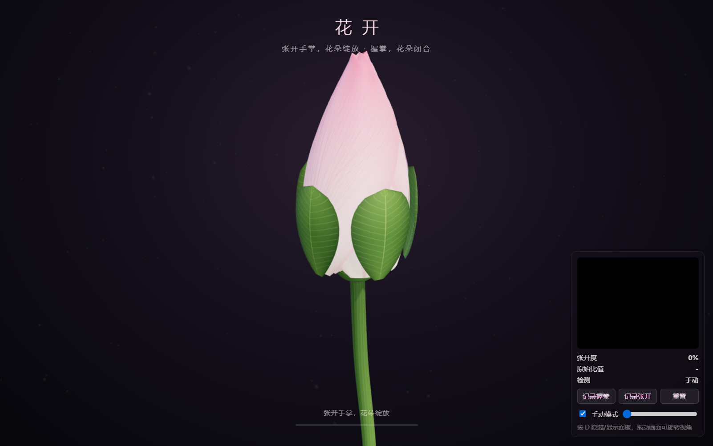
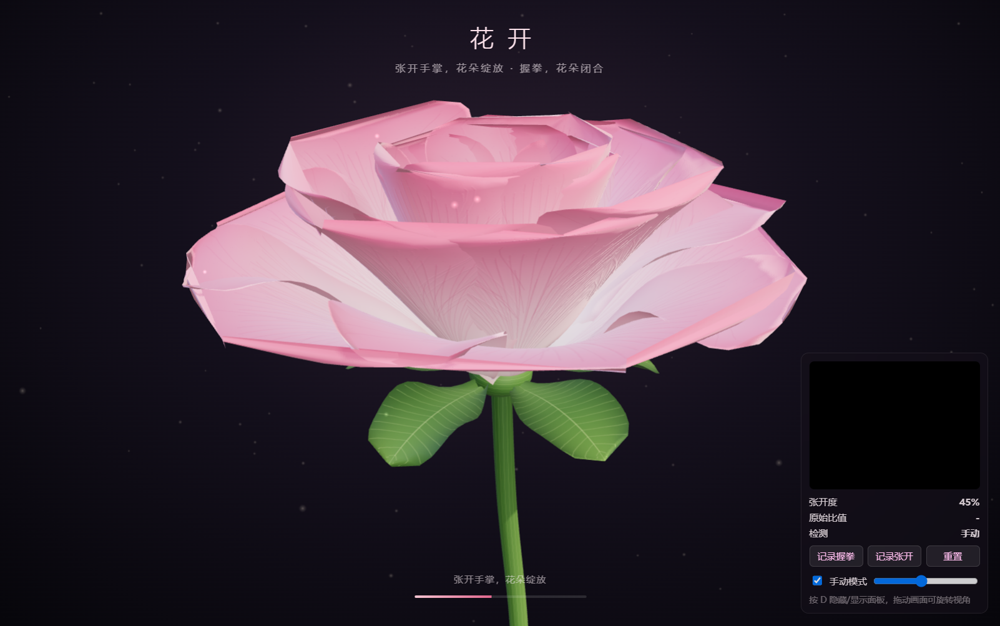
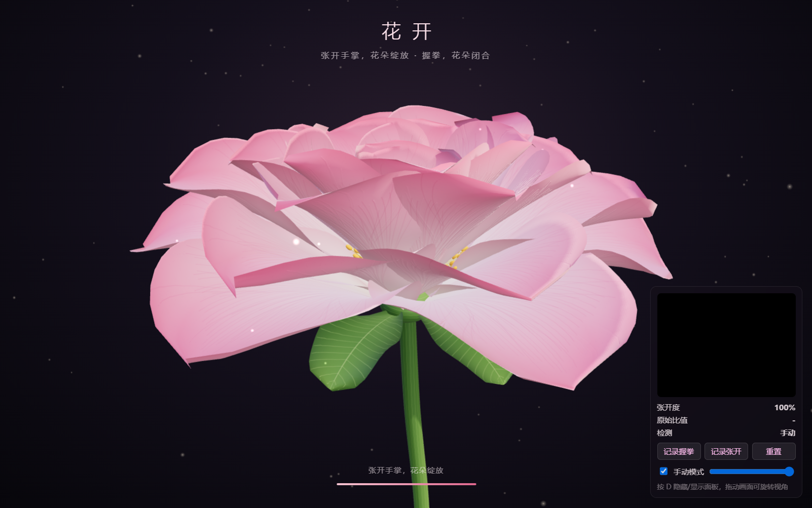

# 花开 · 使用教程

[← 返回首页](../README.md)

- [一、下载](#一下载)
- [二、Windows 安装与启动](#二windows-安装与启动)
- [三、macOS 安装与启动](#三macos-安装与启动)
- [四、怎么玩](#四怎么玩)
- [五、界面说明](#五界面说明)
- [六、校准：让花开得更跟手](#六校准让花开得更跟手)
- [七、手动模式（没有摄像头也能看）](#七手动模式没有摄像头也能看)
- [八、常见问题](#八常见问题)

---

## 一、下载

打开本仓库的 **Releases** 页面，在最新版本下面的 *Assets* 里下载：

| 你的电脑 | 文件 |
|---|---|
| Windows 10 / 11（64 位） | `HuaKai-0.1.0-win-x64.zip` |
| Mac，M1 / M2 / M3 / M4 芯片 | `HuaKai-0.1.0-mac-arm64.dmg` |
| Mac，Intel 芯片 | `HuaKai-0.1.0-mac-x64.dmg` |

**怎么看 Mac 是什么芯片**：点屏幕左上角苹果图标  →「关于本机」，“芯片”一栏写 *Apple M…* 选 arm64，写 *Intel* 选 x64。

**电脑要求**：带摄像头（笔记本自带的或 USB 摄像头都行）；近 5 年内的普通电脑即可流畅运行。

---

## 二、Windows 安装与启动

1. 在下载的 `HuaKai-0.1.0-win-x64.zip` 上**右键 → 全部解压缩**，得到一个文件夹。
   > 不要在压缩包里直接双击运行，程序需要同目录下的其它文件。
2. 打开文件夹，双击 **`HuaKai.exe`**。
3. 第一次运行可能出现的提示：
   - **“Windows 已保护你的电脑”**（蓝色窗口）：点 **更多信息** → **仍要运行**。
   - **“智能应用控制已阻止此应用”**：这是 Windows 11 的安全功能，会拦截没有购买数字签名证书的程序，且没有“仍要运行”按钮。如果遇到，可以在 **Windows 安全中心 → 应用和浏览器控制 → 智能应用控制设置** 中查看；是否关闭该功能请自行权衡安全性后决定。
4. 程序启动后，若弹出摄像头权限请求，请允许。

想以后方便打开：右键 `HuaKai.exe` → **发送到 → 桌面快捷方式**。

---

## 三、macOS 安装与启动

1. 双击下载的 `.dmg` 文件，在弹出的窗口里把 **HuaKai** 图标拖到 **Applications（应用程序）** 文件夹。
2. 打开「启动台」或「应用程序」文件夹，双击 **HuaKai**。
3. 第一次打开会提示 **“无法验证开发者”** 或 **“Apple 无法检查其是否包含恶意软件”**（因为没有付费的苹果开发者签名）：
   1. 先点 **完成 / 取消** 关掉提示；
   2. 打开 **系统设置 → 隐私与安全性**，往下滚动，找到“已阻止使用 HuaKai”，点 **仍要打开**；
   3. 再输入一次开机密码确认。之后就能正常双击打开了。
4. 如果提示 **“HuaKai 已损坏，无法打开”**：打开「终端」，粘贴下面这行并回车，然后再打开程序：
   ```bash
   xattr -cr /Applications/HuaKai.app
   ```
5. 程序会请求**摄像头权限**，点 **允许**。
   - 如果不小心点了“不允许”：**系统设置 → 隐私与安全性 → 摄像头**，把 HuaKai 的开关打开，然后重启程序。

---

## 四、怎么玩

1. 打开程序，等底部提示变成 **“手势识别已就绪 · 请把手放到摄像头前”**（一般 1~2 秒）。
2. 把**一只手**举到摄像头前，手掌朝向摄像头，离镜头 **30~80 厘米**，整只手都在画面里。
3. 动作：

| 你的手 | 花朵 |
|---|---|
| 🖐️ 五指完全张开 | 完全盛开 |
| ✋ 手指微弯、半握 | 半开 |
| ✊ 握拳 | 收拢成花苞 |
| 手离开画面 | 保持 1.5 秒后慢慢合上 |

<p align="center">
  
  
  
</p>

**小技巧**
- 慢慢张开手指，可以看到花瓣从外到内一层层打开。
- 用鼠标**拖动画面**可以旋转视角，花朵也会自己缓慢旋转。
- 按键盘 **D** 隐藏 / 显示右下角面板，适合全屏展示。
- 光线充足、背景不要太乱，识别会更稳定。

---

## 五、界面说明

<p align="center"></p>

- **顶部**：标题和操作提示。
- **底部进度条**：当前开花程度。进度条上方是状态提示（模型是否就绪、是否检测到手）。
- **右下角面板**（按 D 隐藏）：

| 项目 | 说明 |
|---|---|
| 摄像头小窗 | 镜像显示摄像头画面，识别到手时会画出粉色手部骨架 |
| 张开度 | 当前开花程度 0%~100% |
| 原始比值 | 手掌张开的原始测量值，后面方括号是校准范围 `[握拳值 → 张开值]` |
| 检测 | 每秒识别次数（FPS），一般 25~60 |
| 记录握拳 / 记录张开 / 重置 | 校准按钮，见下一节 |
| 手动模式 | 勾选后用滑块控制花朵，不用摄像头 |

---

## 六、校准：让花开得更跟手

每个人手的大小、习惯不同。如果出现**手完全张开了花还没全开**，或**握拳了花还没合上**，做一次校准：

1. 把手放在摄像头前，**握拳**，保持不动，点 **记录握拳**。
2. **五指尽量张开**，保持不动，点 **记录张开**。
3. 完成！面板“原始比值”后面的方括号会变成你的数值，例如 `[1.02→1.96]`。

> 提示：用另一只手点鼠标；或者先握拳，看“原始比值”大概是多少，心里有数后再点。

- 校准结果会**自动保存**，下次打开仍然有效。
- 想恢复默认值（`1.15 → 1.85`），点 **重置**。
- 想让花**更容易开满**：记录张开时手指别张到最大；想让花**更容易合上**：记录握拳时握得松一点。

---

## 七、手动模式（没有摄像头也能看）

勾选面板上的 **手动模式**，拖动右边的滑块即可控制花朵开合。
没有摄像头、摄像头被占用或权限被拒绝时，程序会**自动切换**到手动模式。

---

## 八、常见问题

**Q：提示“无法打开摄像头”？**
- 摄像头是否被其它程序（微信、腾讯会议、Zoom、浏览器）占用 —— 关掉它们再重启花开。
- Windows：**设置 → 隐私和安全性 → 摄像头**，打开“允许桌面应用访问摄像头”。
- Mac：**系统设置 → 隐私与安全性 → 摄像头**，打开 HuaKai。
- 笔记本有物理摄像头开关或快捷键（如 F8 / F10）的，确认已打开。

**Q：识别到了手，但花抖来抖去？**
光线太暗或手离得太远。靠近一点、开灯，或者重新校准。

**Q：花开得很慢 / 跟不上手？**
程序故意加了平滑，让动作更柔和。想要更快响应，参考 [自定义花朵指南](自定义花朵.md#八调整灵敏度与动画速度)。

**Q：检测 FPS 很低（小于 15）？**
关闭其它占用显卡的程序；笔记本请插上电源。程序会优先用显卡（GPU），不支持时自动改用 CPU。

**Q：会上传我的摄像头画面吗？**
不会。手势模型和推理引擎都打包在程序里，画面只在你的电脑上处理，程序不联网。

**Q：可以同时用两只手吗？**
当前只识别一只手（画面里最先识别到的那只）。
