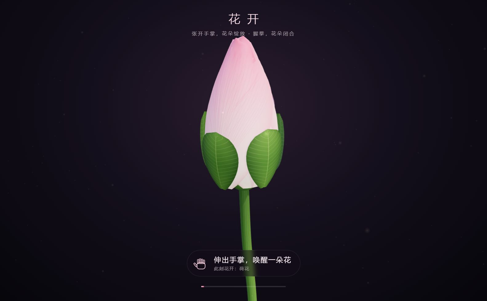
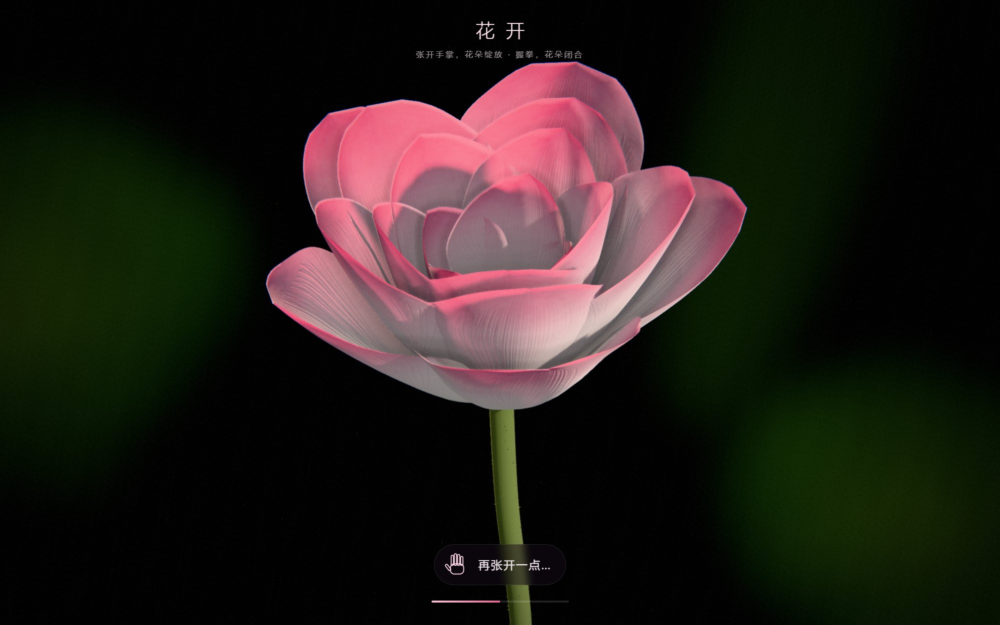
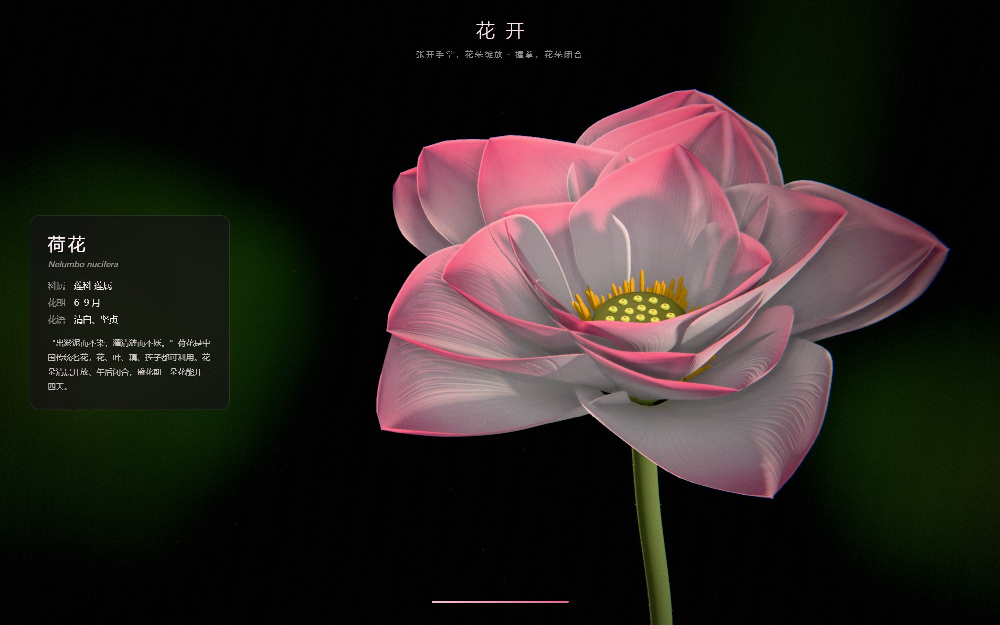
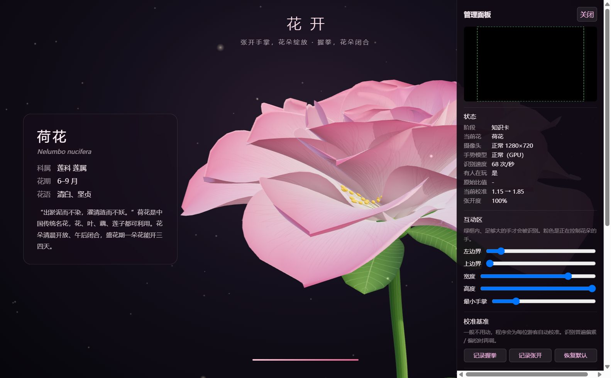

# 花开 · 使用教程

[← 返回首页](../README.md)

- [一、下载](#一下载)
- [二、Windows 安装与启动](#二windows-安装与启动)
- [三、macOS 安装与启动](#三macos-安装与启动)
- [四、游客怎么玩](#四游客怎么玩)
- [五、管理面板（工作人员）](#五管理面板工作人员)
- [六、日常运维](#六日常运维)
- [七、现场布置建议](#七现场布置建议)
- [八、常见问题](#八常见问题)

---

## 一、下载

打开本仓库的 **Releases** 页面，在最新版本下面的 *Assets* 里下载：

| 你的电脑 | 文件 |
|---|---|
| Windows 10 / 11（64 位） | `HuaKai-版本号-win-x64.zip` |
| Mac，M1 / M2 / M3 / M4 芯片 | `HuaKai-版本号-mac-arm64.dmg` |
| Mac，Intel 芯片 | `HuaKai-版本号-mac-x64.dmg` |

**怎么看 Mac 是什么芯片**：点屏幕左上角苹果图标  →「关于本机」，“芯片”一栏写 *Apple M…* 选 arm64，写 *Intel* 选 x64。

**电脑要求**：带摄像头（推荐 1080p 广角 USB 摄像头）；近 5 年内的普通电脑即可流畅运行。

---

## 二、Windows 安装与启动

1. 在下载的 zip 上**右键 → 全部解压缩**，得到一个文件夹，放到固定位置（比如 `D:\HuaKai`）。
   > 不要在压缩包里直接双击运行。
2. 打开文件夹，双击 **`HuaKai.exe`**。程序会**全屏**运行（展台模式）。
3. 第一次运行可能出现的提示：
   - **“Windows 已保护你的电脑”**（蓝色窗口）：点 **更多信息** → **仍要运行**。
   - **“智能应用控制已阻止此应用”**：这是 Windows 11 的安全功能，会拦截没有购买数字签名证书的程序。展厅电脑建议使用 Windows 11 IoT 企业版并统一管理，详见 [产品与架构蓝图](产品与架构蓝图.md)。
4. 如果弹出摄像头权限请求，请允许。

文件夹里的 **`content`** 文件夹是展项内容（花朵、文案、设置），可以直接修改，见 [自定义花朵指南](自定义花朵.md)。

---

## 三、macOS 安装与启动

1. 双击下载的 `.dmg` 文件，把 **HuaKai** 图标拖到 **Applications（应用程序）** 文件夹。
2. 打开「启动台」或「应用程序」文件夹，双击 **HuaKai**。
3. 第一次打开会提示 **“无法验证开发者”**（因为没有付费的苹果开发者签名）：
   1. 先点 **完成 / 取消** 关掉提示；
   2. 打开 **系统设置 → 隐私与安全性**，往下滚动，找到“已阻止使用 HuaKai”，点 **仍要打开**；
   3. 再输入一次开机密码确认。
4. 如果提示 **“HuaKai 已损坏，无法打开”**：打开「终端」，执行下面这行，然后再打开程序：
   ```bash
   xattr -cr /Applications/HuaKai.app
   ```
5. 程序会请求**摄像头权限**，点 **允许**。不小心拒绝了：**系统设置 → 隐私与安全性 → 摄像头**，打开 HuaKai，然后重启程序。

Mac 版想修改内容，把 `content` 文件夹（可从本仓库 `public/content` 复制）放到 `~/Library/Application Support/huakai/content`，见 [自定义花朵指南](自定义花朵.md)。

---

## 四、游客怎么玩

程序会自动循环下面的流程，**不需要工作人员操作**：

| 阶段 | 游客看到什么 |
|---|---|
| 待机 | 一朵花苞轻轻“呼吸”，下方提示“伸出手掌，唤醒一朵花”，并显示此刻是哪种花 |
| 互动 | 游客伸出手掌：张开 → 花开，握拳 → 花合，半握 → 半开 |
| 盛开 | 手完全张开保持约 1 秒：花粉飞散、风铃音效，显示“你唤醒了一朵 XX” |
| 知识卡 | 左侧出现这朵花的学名、科属、花期、花语和简介，约 15 秒 |
| 换花 | 游客离开约 8 秒后，花慢慢合上、沉下去，长出下一种花，回到待机 |

<p align="center">
  
  
  
</p>

**怎么站、怎么伸手**

- 站在摄像头前 **1~2 米**，手掌朝向摄像头，整只手都在画面里。
- 多人同时伸手时，程序只跟随**最近、最靠中间**的那只手，直到这个人离开。
- 不需要校准：程序会在每位游客玩的时候自动学习他握拳和张开的程度，手小的孩子也能开满花。

---

## 五、管理面板（工作人员）

**打开方式**（游客看不到入口）：

- 依次点击屏幕 **左上角 → 右上角 → 右下角 → 左下角**（4 秒内点完），或按键盘 `Ctrl+Shift+A`；
- 输入管理密码，默认 **`2580`**（在 `content/exhibit.json` 的 `admin.pin` 里修改）。

<p align="center"></p>

| 区域 | 用途 |
|---|---|
| 摄像头画面 | 镜像显示摄像头画面。**绿色虚线框是互动区**；粉色骨架是正在控制花朵的手，白色是框内其他手，灰色是框外或太远的手 |
| 状态 | 当前阶段、当前花、摄像头和手势模型是否正常、识别速度（每秒次数，一般 25~60）、当前校准范围、张开度 |
| 互动区 | 拖动滑块调整绿框位置和大小；「最小手掌」越大，越只认站得近的人（可过滤远处路过的人） |
| 校准基准 | 一般不用动。只有在大多数游客都“开不满”或“合不上”时，让同事站在正常位置，握拳点「记录握拳」、张开点「记录张开」 |
| 花朵 | 立即切换到某种花，或「下一朵」 |
| 声音 | 音量，背景音乐开关 |
| 测试 | 勾选「手动模式」后拖动滑块控制花朵，不需要摄像头（关闭面板时自动退出手动模式） |
| 系统 | 开机自动启动、重新加载、重启程序、退出程序；显示版本、内容目录、日志位置 |

- 面板里的调整**只保存在这台电脑上**，不会改动 `content` 文件夹；点「清除本机所有调整」可恢复为配置文件里的设置。
- 关闭面板：点「关闭」或按 `Esc`。

**退出程序**：管理面板 →「退出程序」，或按 `Ctrl+Alt+Shift+Q`。展台模式下 Alt+F4 等常规方式无法关闭程序，这是为了防止游客误关。

---

## 六、日常运维

程序为无人值守设计，以下都是**自动**的：

| 情况 | 程序会怎么做 |
|---|---|
| 页面崩溃或卡死 | 自动重新加载（卡死 30 秒内恢复） |
| 窗口被意外关闭 | 立即重新打开 |
| 摄像头被拔掉、断开或没有画面 | 每 10 秒自动重试，屏幕左下角显示“摄像头未连接” |
| 长时间运行 | 每天定时重启一次（默认凌晨 3:00，在 `exhibit.json` 的 `kiosk.dailyRestart` 修改，填 `null` 关闭） |
| 屏幕休眠 | 程序运行时阻止屏幕休眠 |

**建议设置**

1. 在管理面板里勾选 **开机自动启动**；
2. 电脑 BIOS 里设置“来电自动开机”或定时开机，配合闭馆后关机；
3. Windows 关闭自动更新重启、关闭通知。

**日志**：遇到问题时把日志发给技术人员。位置在管理面板「系统」一栏可以看到：

- Windows：`C:\Users\用户名\AppData\Roaming\huakai\logs\huakai.log`
- Mac：`~/Library/Application Support/huakai/logs/huakai.log`

---

## 七、现场布置建议

- **摄像头**：装在屏幕上沿正中，略向下倾 10~15°。
- **地贴**：距屏幕约 1.5 米贴“站在这里，伸出手掌”。
- **屏幕**：中心离地约 1.4 米，避开窗户直射和强逆光。
- **告示**：“摄像头仅用于识别手势，不录像、不存储”。
- **调互动区**：装好后打开管理面板，让同事站在地贴位置伸手，调整绿框只覆盖互动位置，「最小手掌」调到刚好能识别地贴位置的手。

---

## 八、常见问题

**Q：屏幕左下角显示“摄像头未连接”？**
- 检查 USB 线；摄像头是否被其它程序（微信、会议软件、浏览器）占用。
- Windows：**设置 → 隐私和安全性 → 摄像头**，打开“允许桌面应用访问摄像头”。
- Mac：**系统设置 → 隐私与安全性 → 摄像头**，打开 HuaKai。
- 程序会自动重试，接好后约 10 秒内恢复。

**Q：游客伸手了但花没反应？**
打开管理面板看摄像头画面：手是灰色说明在框外或太远，调整互动区或「最小手掌」；画面太暗就加补光。

**Q：游客路过也会触发？**
把互动区调窄，或把「最小手掌」调大。

**Q：花开得太快 / 太慢，知识卡停留太久？**
在 `content/exhibit.json` 的 `timing` 里调整，见 [自定义花朵指南](自定义花朵.md#五展项设置exhibitjson)。

**Q：识别速度很低（小于 15 次/秒）？**
关闭其它占用显卡的程序；笔记本请插上电源。程序会优先用显卡（GPU），不支持时自动改用 CPU。

**Q：会上传摄像头画面吗？**
不会。手势模型和推理引擎都打包在程序里，画面只在这台电脑上处理，程序不联网。
